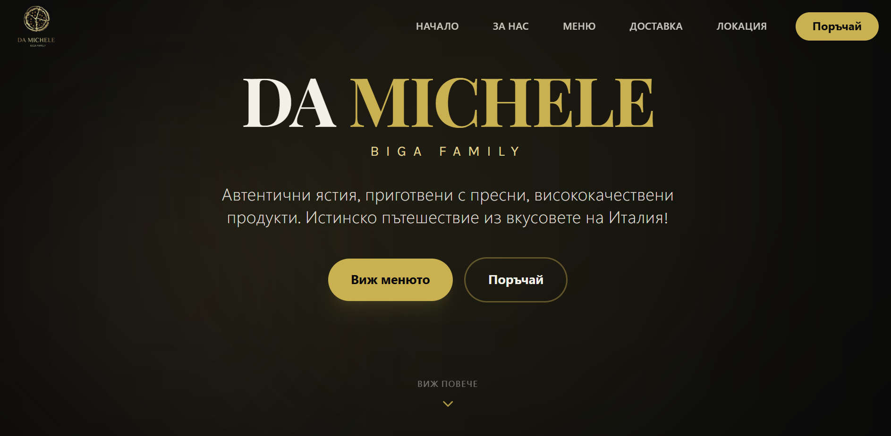
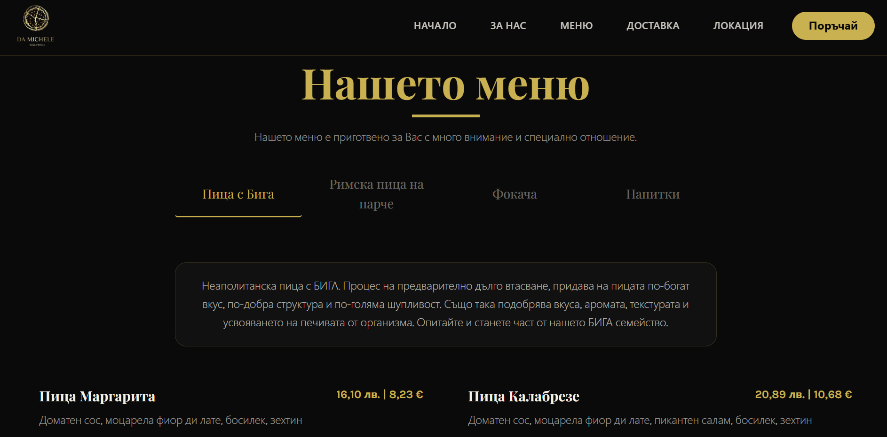
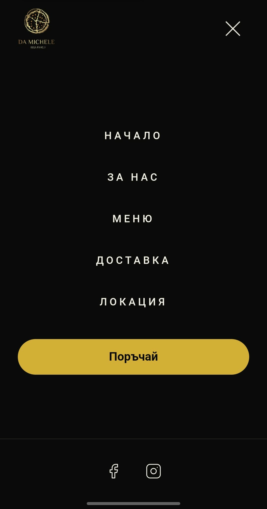

# Da Michele Biga Family — Restaurant Website

A dark-and-gold, single-page marketing website for **Da Michele Biga Family**, a Neapolitan biga pizza restaurant that operated in Sofia, Bulgaria. Built with React, TypeScript, Tailwind CSS and Motion.

> **Status:** The restaurant has permanently closed, so this site is no longer a live client product. The source is published as a portfolio piece.

## About this project

I designed and built this website for Da Michele Biga Family as a real project for a real restaurant. The goal was to give the pizzeria a polished online presence: its story, a browsable menu, ways to order, customer reviews, and directions.

The restaurant has since closed for good. Because the business no longer exists, I'm making the repository public to show the work. The contact details, links and ratings below are the restaurant's original details as they were in the project. They are no longer active.

The site is in Bulgarian, the restaurant's customer language.

### Restaurant details (original)

| | |
| --- | --- |
| **Name** | Da Michele Biga Family |
| **Address** | ул. „Георги С. Раковски“ 146, 1142 София, България |
| **Phone** | 0893 022 430 (`+359893022430`) |
| **Google rating** | 4.8 / 5 (about 50 reviews, as shown on the site) |
| **Google Maps** | [maps.app.goo.gl/mLwVDV6QvtHvGoBv7](https://maps.app.goo.gl/mLwVDV6QvtHvGoBv7) |
| **Wolt** | [wolt.com/.../da-michele-sof](https://wolt.com/bg/bgr/sofia/restaurant/da-michele-sof) |
| **Facebook** | [Da Michele Biga Family](https://www.facebook.com/p/Da-Michele-Biga-Family-61574447975886/) |
| **Instagram** | [@damichele.95](https://www.instagram.com/damichele.95/) |

These values live in `src/lib/site.ts` and drive the navbar, footer, location section, delivery links and order modal.

## Screenshots

### Desktop hero



### Menu



### Mobile navigation



## Features

- **Hero section** with the animated brand title, tagline and two calls to action: view the menu or start an order.
- **About section** telling the story of the restaurant's biga dough, with an image and scroll-triggered animation.
- **Categorized menu** with four categories (Пица с Бига, Римска пица на парче, Фокача, Напитки). Switching categories animates the list. Prices are shown in both BGN and EUR, and the two pizza categories include a short description. The menu is driven by a typed data file, `src/data/menuData.ts`.
- **Order modal** that opens from the hero, navbar, menu and call-to-action section. The headline asks **„Как желаете да поръчате?“** and offers ordering through **Wolt** or by **phone call**. It closes with the `Escape` key or a click on the backdrop.
- **Delivery section** that promotes ordering from home through the same Wolt and phone options.
- **Customer reviews** with an aggregate Google rating (4.8) shown as partially filled stars, plus review cards.
- **Location section** with the Rakovski Street address, phone, a Google Maps link and an embedded map.
- **Final call-to-action** block with a click-to-call button and an order button.
- **Responsive navigation** with a fixed navbar that gains a blurred background on scroll, and a full-screen mobile menu that locks page scrolling and closes with `Escape`.
- **Scroll progress bar** at the top of the page, driven by a spring animation.
- **Motion** from entrance and scroll-reveal animations. Reduced-motion preferences are respected in the hero scroll hint.
- **Accessibility touches**: a skip-to-content link, ARIA labels and roles on dialogs and groups, `aria-pressed` on category tabs, visible focus rings, and minimum touch target sizes.
- **Dark and gold branding** with a black and champagne-gold palette, Playfair Display for headings and Karla for body text.
- **SEO basics**: page title and meta description in `index.html`.
- **Centralized business data** in `src/lib/site.ts` (name, phone, address, links, rating), so contact details live in one place.

## Tech stack

| Area | Technology |
| ---- | ---------- |
| Framework | React 19 |
| Language | TypeScript 5.8 |
| Build tool | Vite 6 |
| Styling | Tailwind CSS 4 (via `@tailwindcss/vite`) |
| Animation | Motion (`motion/react`) |
| Icons | Lucide React |
| Utilities | `clsx`, `tailwind-merge` |
| Fonts | Google Fonts (Playfair Display, Karla) |

## Getting started

**Prerequisites:** Node.js and npm.

```bash
# Install dependencies
npm install

# Start the dev server
npm run dev
```

The dev server runs at **http://localhost:3009/**.

### Scripts

| Command | Description |
| ------- | ----------- |
| `npm run dev` | Start the Vite dev server on port 3009 |
| `npm run build` | Create a production build |
| `npm run preview` | Preview the production build locally |
| `npm run lint` | Type-check with TypeScript (`tsc --noEmit`) |

## Project structure

```
damichele/
├── docs/screenshots/        # README images
├── src/
│   ├── components/
│   │   ├── Navbar.tsx             # Fixed nav + mobile menu
│   │   ├── Hero.tsx               # Landing hero
│   │   ├── Menu.tsx               # Category tabs + item list
│   │   ├── DeliveryBanner.tsx     # Delivery section
│   │   ├── DeliveryPlatforms.tsx  # Wolt + phone links
│   │   ├── OrderPlatformModal.tsx # Order dialog
│   │   ├── OrderModalContext.tsx  # Shared open-modal context
│   │   ├── Reviews.tsx            # Rating + review cards
│   │   ├── Location.tsx           # Contact info + map
│   │   ├── Footer.tsx
│   │   └── Logo.tsx
│   ├── data/menuData.ts     # Typed menu content
│   ├── lib/
│   │   ├── site.ts          # Business info and links
│   │   └── utils.ts         # Class name helper
│   ├── App.tsx              # Page composition, about and CTA sections
│   ├── main.tsx
│   └── index.css            # Tailwind theme (colors, fonts)
├── index.html
├── package.json
└── vite.config.ts
```

## Notes

- Phone, address, Wolt, Maps and social links are the restaurant's original details from when the site was built. The restaurant has closed; those links may no longer work.
- This is a front-end only project with no backend or database.

## Author

Built by me as the developer of the Da Michele Biga Family website.
